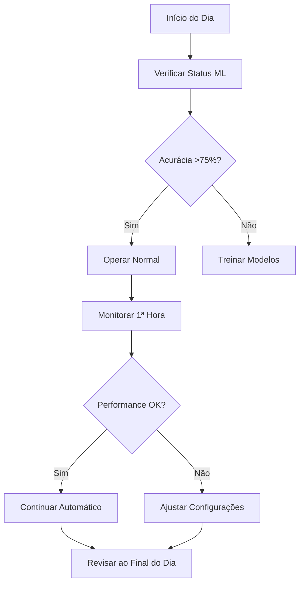

# 🚀 Guia Completo de Uso das Novas Funcionalidades de Machine Learning

## 📋 Índice
- [1. Configuração Inicial](#1-configuração-inicial)
- [2. Painel de Controle ML](#2-painel-de-controle-ml)
- [3. Operação com ML Ativo](#3-operação-com-ml-ativo)
- [4. Análise e Monitoramento](#4-análise-e-monitoramento)
- [5. Exemplos Práticos](#5-exemplos-práticos)
- [6. Dicas de Otimização](#6-dicas-de-otimização)
- [7. Solução de Problemas](#7-solução-de-problemas)
- [8. FAQ e Dicas Rápidas](#8-faq-e-dicas-rápidas)

---

## 1. Configuração Inicial

### 1.1 Ativação do Sistema ML

Ao abrir o bot pela primeira vez, localize na coluna direita o painel **"Configurações de Machine Learning"**:

```typescript
📊 Configurações de Machine Learning
├── ✅ Usar Machine Learning
├── ✅ Aprendizado Online  
├── ✅ Treinamento Automático
├── Limite Confiança: 70% ──────○
└── Janela de Análise: 50 ticks ─○
```

**Passos de ativação:**
1. **Ative o toggle "Usar Machine Learning"** - Habilita todas as funcionalidades de IA
2. **Deixe "Aprendizado Online" ativado** - Sistema melhora automaticamente
3. **Ajuste "Limite de Confiança"** - Recomendado: 70% inicial
4. **Configure "Janela de Análise"** - 50 ticks é ideal para começar

### 1.2 Configuração de Operações

Na aba **"Configurações"** → **"Operações Customizáveis"**:

```typescript
🎯 Operações Customizáveis
├── 🔴 OVER Específico
│   └── Dígitos: [2, 3, 4] → Opera quando dígito > 4
├── 🔵 UNDER Específico  
│   └── Dígitos: [7, 8, 9] → Opera quando dígito < 7
├── 🟢 MATCHES Específico
│   └── Dígito: 5 → Opera quando dígito = 5
└── 🟣 DIFFERS Customizável
    └── Dígitos: [1, 5] → Opera quando dígito ≠ 1,5
```

**Recomendações iniciais:**
- Comece com **OVER 2** e **UNDER 7** apenas
- Adicione mais operações gradualmente
- Monitore performance antes de expandir

---

## 2. Painel de Controle ML

### 2.1 Painel Principal

```typescript
🤖 Configurações de Machine Learning
├── Status: ML ATIVO (verde)
├── Sistema ML: ATIVADO
├── Aprendizado Online: ATIVO
├── Treinamento Automático: ATIVO
├── Limite Confiança ML: 70%
├── Janela de Análise: 50 ticks
├── [Salvar Modelos] [Exportar Dados]
└── Status do Sistema:
    ├── TensorFlow.js: ✅ Pronto
    ├── Modelos: ✅ Carregados  
    ├── Memória: ✅ OK
    └── Performance: ✅ Boa
```

### 2.2 Estatísticas em Tempo Real

```typescript
📊 Estatísticas
├── Símbolos Monitorados: 3
├── Total de Dígitos: 1,245
├── Sinais Gerados: 48
├── Alta Confiança: 32
├── Média Confiança: 16
└── 🤖 Machine Learning
    ├── Acurácia: 87.5%
    ├── Latência: 3.2ms
    ├── Amostras: 15,247
    └── Modelos: 4 ativos
```

---

## 3. Operação com ML Ativo

### 3.1 Modo Manual com ML

**Quando usar:** Para entender como o ML funciona

**Passos:**
1. **Conecte à Deriv** com seu API Token
2. **Selecione volatilidades** (R_100 e R_75 recomendados)
3. **Vá para aba "Dashboard"**
4. **Observe o card "MELHOR ENTRADA"**:
   
```typescript
🎯 MELHOR ENTRADA (ML)
├── Estratégia: ML_OVER_SPECIFIC
├── Ativo: R_100
├── Confiança: 87.3% (ML: 92%)
├── Lucro Esperado: +0.95
└── Gatilhos:
    ├── Dígitos 0,1,2 exaustos
    └── ML conf: 92.1%
```

5. **Execute manualmente** ou deixe no automático

### 3.2 Modo Automático com ML

**Quando usar:** Para operações 24/7

**Configuração automática:**
```typescript
⚙️ Configurações de Risco
├── Stake: $1.00
├── Stop Loss: $50.00
├── Stop Win: $100.00
├── Martingale: DESATIVADO (inicial)
└── ML Ativo: ✅ SIM
```

**O sistema opera automaticamente:**
- Analisa ticks em tempo real
- Gera sinais com ML
- Executa trades quando confiança ≥ limite configurado

### 3.3 Controles de Assertividade

```typescript
⚠️ Controles de Assertividade
├── Confiança Mínima: 70% ──────────○
│   └── Só opera se confiança ≥ 70%
├── Limite Exaustão: 5 vezes ───────○
│   └── Dígito exausto após 5+ vezes
└── Limite Ausência: 15 ticks ──────○
    └── Dígito ausente após 15+ ticks
```

**Progressão recomendada:**
- **Início:** Confiança 70%, Exaustão 5, Ausência 15
- **Após 100 trades:** Confiança 75%, Exaustão 4, Ausência 12
- **Expert:** Confiança 80%, Exaustão 3, Ausência 10

---

## 4. Análise e Monitoramento

### 4.1 Aba "Análise ML"

```typescript
🤖 Análise de Machine Learning
├── 📈 Estatísticas ML
│   ├── Acurácia: 87.5% (✅)
│   ├── Amostras: 15.2k
│   ├── Latência: 3.2ms
│   └── Último Treino: 14:30
├── ⚙️ Configurações Ativas
│   ├── ML Ativo: SIM
│   ├── Aprendizado Online: ATIVO
│   ├── Limite Confiança: 70%
│   └── [Treinar Modelos Agora]
└── 🎯 Previsões Atuais
    ├── Confiança ML: 92.1%
    ├── Dígito Previsto: 8
    └── Top 3 Probabilidades:
        ├── Dígito 8: 38.5% 🥇
        ├── Dígito 7: 22.3% 🥈
        └── Dígito 9: 18.7% 🥉
```

### 4.2 Interpretação de Sinais ML

**Características dos sinais com ML:**
- **Badge "ML"** na estratégia
- **Confiança combinada** (60% ML + 40% heurística)
- **Razões específicas** do ML

**Exemplo de sinal:**
```typescript
✅ Sinal ML Detectado
├── Estratégia: ML_OVER_SPECIFIC
├── Confiança: 87% (ML: 92%)
├── Motivo: Dígitos 0-2 exaustos + ML prevê >2
└── Ação: DIGITOVER com barreira 2
```

### 4.3 Métricas de Performance

| Métrica | Bom | Ruim | Ação |
|---------|-----|------|------|
| **Acurácia ML** | >80% | <60% | Treinar mais |
| **Latência** | <10ms | >50ms | Reduzir features |
| **Amostras** | >10k | <1k | Coletar mais dados |
| **Conf. Média** | >75% | <65% | Ajustar limite |

---

## 5. Exemplos Práticos

### 5.1 Exemplo 1: Teste Rápido (30 minutos)

**Objetivo:** Testar funcionalidades básicas do ML

```typescript
// Configuração inicial
{
  "ML": "ATIVO",
  "Confiança": "70%",
  "Modo": "MANUAL",
  "Volatilidades": "R_100 apenas",
  "Operações": "OVER 2"
}
```

**Passos:**
1. Conectar à Deriv
2. Ir para aba "Dashboard"
3. Observar "MELHOR ENTRADA"
4. Verificar se aparece "ML" nos sinais
5. Aguardar sinal com confiança >80%
6. Executar trade manual

### 5.2 Exemplo 2: Operação Noturna (8 horas)

**Configuração para rodar durante a noite:**

```typescript
⚙️ Configuração Noturna
├── ML: ATIVO
├── Modo: AUTOMÁTICO
├── Stake: $0.50
├── Stop Loss: $25
├── Stop Win: $50
├── Volatilidades: R_100, R_75, R_50
├── Operações: OVER 2, UNDER 7
└── Martingale: ATIVO (2x, 3 níveis)
```

**Monitoramento (a cada 2 horas):**
1. Verificar acurácia ML (>75%?)
2. Checar total trades (5-10 por hora?)
3. Analisar lucro/perda
4. Verificar alertas do sistema

### 5.3 Exemplo 3: Otimização Avançada

**Após 500 trades:**

```typescript
🎯 Otimização Baseada em Dados
├── Analisar histórico:
│   ├── ML acurácia: 84%
│   ├── Melhor horário: 14h-18h GMT
│   ├── Melhor volatilidade: R_75
│   └── Operação mais lucrativa: UNDER 7
│
├── Novas configurações:
│   ├── Confiança ML: 78%
│   ├── Operar apenas R_75
│   ├── Focar em UNDER 7
│   └── Janela análise: 35 ticks
│
└── Ações:
    - Clicar em "Treinar Modelos Agora"
    - Usar dados das últimas 24h
    - Exportar relatório de performance
```

---

## 6. Dicas de Otimização

### 6.1 Para Iniciantes (Primeira Semana)

```typescript
📋 Checklist Semana 1
├── Dia 1-2: Modo MANUAL, observar ML
├── Dia 3-4: Modo AUTOMÁTICO, stake $0.10
├── Dia 5-6: Analisar estatísticas ML
└── Dia 7: Ajustar configurações baseado em dados
```

**Configuração segura inicial:**
```json
{
  "mlConfig": {
    "useML": true,
    "confidenceThreshold": 70,
    "onlineLearning": true,
    "featureWindow": 50
  },
  "trading": {
    "stake": 0.10,
    "stopLoss": 10,
    "stopWin": 20,
    "martingale": false
  },
  "operations": ["OVER_2", "UNDER_7"]
}
```

### 6.2 Para Intermediários (Após 100 trades)

```typescript
🎯 Otimizações Intermediárias
├── 1. Analisar "Resultados" tab
│   ├── Operação mais lucrativa?
│   ├── Melhor horário?
│   └── Melhor volatilidade?
│
├── 2. Ajustar ML baseado em dados
│   ├── Acurácia <70% → Mais treinamento
│   ├── Falsos positivos → Aumentar confiança
│   └── Perdas consecutivas → Revisar estratégia
│
└── 3. Personalizar operações
    ├── Focar nas mais lucrativas
    ├── Adicionar condições específicas
    └── Usar martingale se drawdown controlado
```

### 6.3 Para Avançados (Após 1000 trades)

```typescript
🚀 Otimizações Avançadas
├── 1. Modelos personalizados
│   ├── Treinar com dados específicos
│   ├── Criar modelo por volatilidade
│   └── Exportar/Importar modelos
│
├── 2. Estratégias complexas
│   ├── Combinar múltiplas condições ML
│   ├── Usar aprendizado por reforço
│   └── Implementar stop dinâmico
│
└── 3. Automatização total
    ├── API para monitoramento externo
    ├── Alertas Telegram/Discord
    └── Backtesting automático
```

---

## 7. Solução de Problemas

### Problema 1: "ML não está gerando sinais"

**Diagnóstico:**
```typescript
🔍 Verificar:
1. ML está ATIVO? (toggle verde)
2. Limite de confiança muito alto? (70% inicial)
3. Coleta de dados suficiente? (mínimo 100 ticks)
4. Conexão Deriv estável?
```

**Solução:**
```typescript
✅ Ações:
- Reduzir limite para 65% temporariamente
- Adicionar mais volatilidades
- Clicar em "Treinar Modelos Agora"
- Verificar conexão WebSocket
```

### Problema 2: "Acurácia ML muito baixa (<60%)"

**Causas possíveis:**
1. Poucos dados de treino
2. Features inadequadas
3. Overfitting do modelo

**Soluções:**
```typescript
🛠️ Correções:
- Coletar mais dados (rodar 24h)
- Reduzir janela de análise para 30 ticks
- Treinar com dados específicos do período
- Verificar qualidade dos dados históricos
```

### Problema 3: "Latência muito alta (>50ms)"

**Causas:**
1. Muitas features sendo calculadas
2. Hardware limitado
3. Muitos modelos carregados

**Soluções:**
```typescript
⚡ Otimizações:
- Reduzir janela de features para 30
- Usar apenas 2-3 volatilidades
- Fechar outras abas do navegador
- Usar backend CPU se WebGL lento
```

### Problema 4: "Erro de shape do modelo"

**Mensagem de erro comum:**
```
Error: expected input to have shape [null,35] but got [1,30]
```

**Solução imediata:**
```bash
# 1. Limpar cache do modelo
rm -rf .next
# No navegador: DevTools → Application → Clear Storage

# 2. Reiniciar o bot
# 3. Se persistir, desativar e reativar ML
```

---

## 8. FAQ e Dicas Rápidas

### ❓ Perguntas Frequentes

**Q: Quanto tempo leva para o ML começar a funcionar bem?**
**A:** 24-48 horas de coleta de dados (5k-10k ticks)

**Q: Posso usar ML com martingale?**
**A:** Sim, mas comece com martingale desativado até entender o comportamento

**Q: Qual o consumo de memória do ML?**
**A:** Aproximadamente 50-100MB no navegador

**Q: Os modelos são salvos localmente?**
**A:** Sim, no IndexedDB do navegador

### 💡 Dicas Rápidas

1. **Comece sempre no modo MANUAL** para observar
2. **Use stakes pequenos** ($0.10 a $1.00) inicialmente
3. **Monitore pelo menos 2x ao dia** nos primeiros dias
4. **Exporte dados periodicamente** para backup
5. **Teste em conta DEMO** antes de usar real

### 🎯 Próximos Passos Recomendados

1. **Agora:** Ative o ML e observe por 30 minutos
2. **Hoje:** Faça 3-5 trades manuais para testar
3. **Amanhã:** Analise estatísticas e ajuste configurações
4. **Esta semana:** Deixe rodando automático por períodos curtos
5. **Próxima semana:** Otimize baseado em dados coletados

---

## 📞 Suporte Técnico

### Comandos de Diagnóstico

```bash
# Verificar versões
node --version
npm --version
npm list @tensorflow/tfjs

# Limpeza completa
npm cache clean --force
rm -rf node_modules/.cache
rm -rf .next
```

### Logs Importantes para Compartilhar

Quando pedir ajuda, compartilhe:
1. Erro completo do console
2. Configurações atuais do ML
3. Quantidade de trades realizados
4. Acurácia atual do ML
5. Screenshot do painel de estatísticas

---

## 📊 Fluxo de Trabalho Recomendado



---

## ✅ Checklist de Implantação

- [ ] Ativar ML no painel de controle
- [ ] Configurar limite de confiança (70% inicial)
- [ ] Selecionar operações (OVER 2 e UNDER 7)
- [ ] Definir stake inicial ($0.10 - $1.00)
- [ ] Configurar stop loss e stop win
- [ ] Testar em modo MANUAL primeiro
- [ ] Monitorar acurácia ML
- [ ] Ajustar configurações baseado em dados
- [ ] Expandir para modo AUTOMÁTICO gradualmente

---

**📝 Nota Importante:** O ML é uma ferramenta poderosa, mas não infalível. Sempre use gestão de risco adequada e nunca arrisque mais do que pode perder. O sistema melhora com o tempo - seja paciente durante as primeiras 24-48 horas de operação.

Boa sorte e boas trades! 🚀📈

---


