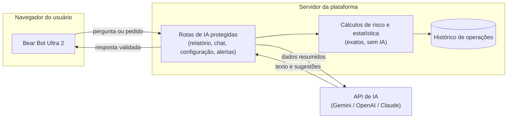

# Bear Bot Ultra 2 — Proposta de Funcionalidades com API de Inteligência Artificial

## 1. Objetivo

Este documento apresenta as funcionalidades que podemos adicionar ao Bear Bot Ultra 2 com uma API de Inteligência Artificial (como Google Gemini, OpenAI ou Anthropic Claude). As propostas partem de uma análise de tudo o que o robô já faz hoje: modos Over, Under, Differ e Combo, Loss Virtual, Dígitos Dinâmicos, Dígito Automático, Padrão A→B, Score de Oportunidade, Múltiplos Mercados, Martingale, Pós-Loss, Paper Trading e as proteções de risco.

---

## 2. Premissa importante: o que a IA pode e o que não pode fazer

Os mercados em que o robô opera (Volatilidade 10 a 100, Bear Market e Bull Market) são **índices sintéticos** da Deriv. O preço desses índices vem de um gerador de números aleatórios auditado, e cada tick é independente do anterior.

Disso decorre uma regra que orienta toda esta proposta:

> **Nenhuma IA consegue prever o próximo dígito.** Qualquer funcionalidade que prometa "prever" ou "detectar padrões ocultos" nos dígitos estaria encontrando padrões no ruído. Isso gera expectativa falsa no usuário final e risco para a reputação do produto.

Onde a IA agrega valor de verdade:

| A IA é forte em… | A IA não deve ser usada para… |
| :--- | :--- |
| Explicar o que o robô está fazendo e por quê | Prever o próximo dígito |
| Ajudar a montar uma configuração coerente | Decidir em tempo real se entra ou não numa operação |
| Analisar o histórico e escrever relatórios | Inventar "regimes", "ciclos" ou "correlações" entre mercados |
| Alertar sobre risco e comportamento perigoso | Escolher o dígito-alvo da operação |
| Comparar estratégias com rigor estatístico | Substituir os cálculos matemáticos do robô |

Uma regra técnica complementa essa: **a IA nunca fica no caminho da compra.** O robô executa ordens em menos de 10 milissegundos, e uma consulta à IA leva de 0,5 a 2 segundos. Por isso a IA só aconselha, explica e ajusta configurações. A decisão de cada operação continua no motor matemático do robô, que é rápido, previsível e testado.

---

## 3. Ponto de partida

- **O que hoje é chamado de "IA" no robô é estatística local.** O Score de Oportunidade e o Radar de Dígitos são cálculos matemáticos (frequências, cadeia de Markov, intervalo de Wilson, qui-quadrado). Não há chamada a nenhuma API de IA. A integração seria construída do zero.
- **As operações reais já ficam salvas.** As operações na conta real do Bear Bot Ultra 2, do Bear Bot Ultra, do Bear Bot Differ e do BotTrader passaram a ser gravadas no banco de dados, junto com os detalhes completos do contrato. Esse histórico é a matéria-prima de várias funcionalidades abaixo (relatórios, auditoria, alertas).

---

## 4. Funcionalidades recomendadas

### Fase 1 — Valor imediato e baixo risco

#### 4.1 Relatório de Sessão Inteligente

Ao final de uma sessão, ou quando o usuário pedir, a IA gera um relatório em linguagem simples com:

- Resultado da sessão: lucro, taxa de acerto real comparada à taxa esperada do modo usado e maior sequência de perdas.
- Momentos críticos: em que ponto o Martingale chegou mais perto de estourar e o que levou a isso.
- Coerência da configuração: se o Stop Loss é compatível com o nível de Martingale usado, por exemplo.
- Sugestões objetivas de ajuste.

Os números (lucro, sequências, quantos níveis de Martingale o saldo suporta) são calculados pelo próprio sistema, com exatidão. A IA só transforma esses números num texto claro. O relatório pode ser gerado automaticamente ao atingir o Stop Win ou o Stop Loss, ou ao desligar o robô.

**Valor para o usuário:** substitui a análise manual de planilhas por um parecer profissional em segundos.

#### 4.2 Assistente de Configuração (Copiloto)

O usuário descreve o que quer em linguagem natural, por exemplo: *"Tenho $100 de banca, quero arriscar pouco e buscar $5 por dia."* A IA propõe uma configuração completa: modo, stake, Martingale, Stop Loss, Stop Win, Loss Virtual, perfil do Score e limite de operações por hora.

- O sistema valida a sugestão antes de mostrá-la, garantindo faixas permitidas e combinações compatíveis entre as opções.
- O usuário vê o que muda em relação à configuração atual e aceita com um clique ou ajusta manualmente.
- A sugestão **nunca é aplicada automaticamente** em conta real.
- O foco é o dimensionamento do risco (stake em relação à banca, profundidade do Martingale, limites). O assistente não indica "o melhor mercado" nem "o melhor dígito", porque isso seria ruído.

**Valor para o usuário:** o robô tem dezenas de parâmetros que dependem uns dos outros. O assistente reduz drasticamente a curva de aprendizado e os erros de configuração.

#### 4.3 Chat Explicativo do Robô

Um painel de conversa em que o usuário pergunta sobre o estado do robô e recebe respostas baseadas nos dados reais daquele momento:

- *"Por que o robô não entrou na última oportunidade?"*
- *"O que o Loss Virtual está esperando agora?"*
- *"Por que o Score caiu de 70 para 30?"*
- *"O que significa o Dígito Dinâmico estar no 4?"*

O chat explica o comportamento do robô. Ele não dá palpites sobre o mercado: a perguntas como *"devo entrar agora?"*, responde de forma honesta, explicando o que os indicadores mostram e lembrando que o resultado de cada tick é aleatório.

**Valor para o usuário:** resolve a principal fonte de dúvida e de chamados de suporte, que é não entender por que o robô fez ou deixou de fazer algo.

#### 4.4 Alertas de Risco

O sistema monitora a sessão e avisa o usuário de forma proativa:

- *"Martingale no nível 3. O saldo atual cobre apenas mais 1 perda."*
- *"Sua taxa de acerto nesta sessão está bem abaixo do esperado para o modo Differ. Considere pausar e revisar a configuração."*
- *"Seu multiplicador de Martingale não recupera as perdas com o pagamento atual deste contrato."*

Os cálculos (níveis de Martingale suportados, probabilidade de sequências de perda, pagamento do contrato) são feitos pelo sistema. A IA prioriza e redige os alertas. O alerta pode opcionalmente pausar o robô.

**Valor para o usuário:** proteção real de capital, que é o que mais gera confiança no produto.

---

### Fase 2 — Diferenciais avançados

#### 4.5 Auditoria Honesta do Score e do Radar de Dígitos

Com o histórico de operações salvo, o sistema cruza o Score de Oportunidade registrado no momento de cada entrada com o resultado real da operação. Faz o mesmo com o Dígito Dinâmico, comparando sua taxa de acerto com os 90% teóricos do modo Differ. A IA apresenta o veredito com margem de confiança estatística:

- *"Entradas com Score acima de 60 tiveram 91% de acerto, contra 89% abaixo de 60. Com 340 operações, essa diferença ainda está dentro da margem de sorte."*

**Valor para o cliente:** permite afirmar com dados se cada filtro do robô melhora ou não os resultados. É a base para decisões de produto e para uma comunicação transparente com os usuários.

#### 4.6 Laboratório de Estratégias (Comparação A/B no Paper Trading)

O usuário escolhe duas ou mais configurações, e o robô as executa em paralelo no Paper Trading, sem dinheiro real, recebendo exatamente os mesmos ticks. Ao final, a IA compara os resultados e informa se a diferença entre elas é significativa ou se pode ser explicada pela sorte.

**Valor para o usuário:** testar estratégias sem arriscar capital e sem cair na ilusão de que "uma configuração ganhou, então é melhor".

#### 4.7 Detector de Comportamento de Risco (Anti-Tilt)

O sistema identifica padrões de comportamento conhecidos por causar grandes perdas:

- Aumentar a stake logo após uma sequência de perdas.
- Desligar o Stop Loss no meio da sessão.
- Trocar de estratégia repetidamente após perdas.
- Continuar operando depois de bater a meta do dia.

A IA gera um aviso respeitoso e contextualizado, sugerindo uma pausa.

**Valor para o usuário:** proteção contra o fator emocional, a maior causa de perda em operações automatizadas. É também um diferencial de mercado forte e de responsabilidade com o usuário.

#### 4.8 Diagnóstico de Falhas de Execução

A IA analisa os registros técnicos da sessão (ordens rejeitadas pela corretora, Combo executado só com uma perna, tempo limite de confirmação atingido) e explica a causa provável em linguagem simples, com a ação recomendada. Exemplo: *"3 ordens foram rejeitadas por saldo insuficiente após o Martingale nível 4."*

**Valor:** reduz o tempo de suporte e o número de chamados.

---

### Recursos de apoio (sem custo de IA)

#### 4.9 Narração das Decisões do Robô

Cada decisão do robô (entrada, operação bloqueada, troca de mercado, pausa) passa a ser registrada com o motivo, e esse motivo vira uma frase clara no log:

- *"Entrada bloqueada: Score 32 abaixo do mínimo de 40."*
- *"Aguardando Loss Virtual: 2 de 3 perdas."*
- *"Pausa pós-loss: 15 segundos restantes."*

Essa narração é feita por modelos de texto prontos, sem chamar a IA. Assim é instantânea, gratuita e sempre correta. Esse mesmo registro de motivos alimenta o Chat Explicativo, os relatórios e a auditoria, por isso deve ser construído primeiro.

---

## 5. Ideias avaliadas e não recomendadas

Algumas ideias comuns para "IA em robôs de trading" foram avaliadas e não são recomendadas para este produto:

| Ideia | Por que não recomendamos |
| :--- | :--- |
| **Previsão de dígitos com IA** | Os dígitos são aleatórios e independentes. Um modelo que "encontra padrões" nesses dados está encontrando ruído. Além de não funcionar, gera uma promessa enganosa ao usuário final. |
| **IA aprovando cada entrada em tempo real** | A consulta à IA leva até 2 segundos, contra menos de 10 milissegundos da execução atual. As cotações perderiam a validade, o custo cresceria a cada operação e o comportamento do robô deixaria de ser previsível e testável. |
| **Detecção de "regimes" ou "ciclos" de mercado** | Em dados aleatórios, regimes e ciclos não existem. A uniformidade da distribuição dos dígitos já é medida matematicamente pelo teste qui-quadrado do robô. |
| **Correlação entre mercados ("líder e seguidor")** | Os índices sintéticos são independentes entre si. Qualquer correlação encontrada seria coincidência. |
| **Melhores horários para operar** | O gerador aleatório não depende do horário. Diferenças de resultado por horário são variação de amostra. |
| **IA narrando cada operação** | O custo seria alto e o texto poderia reforçar crenças erradas, como "o dígito voltou ao normal, como esperado". A narração por modelos prontos (item 4.9) cumpre esse papel com exatidão e sem custo. |

---

## 6. Como a integração funciona

Princípios técnicos:

| Aspecto | Como será feito |
| :--- | :--- |
| **Segurança** | A chave da API de IA fica só no servidor. O navegador nunca fala direto com o provedor de IA. |
| **Exatidão** | Todo número (lucro, probabilidades, níveis de Martingale) é calculado pelo sistema. A IA só interpreta e redige. |
| **Validação** | Toda sugestão da IA é conferida antes de chegar ao usuário. Configurações inválidas são descartadas. |
| **Custo controlado** | Limite de consultas por usuário, cache de respostas e envio de dados resumidos em vez de ticks brutos. |
| **Disponibilidade** | Se a IA falhar ou demorar, o robô continua operando normalmente. Nenhuma funcionalidade de trading depende dela. |
| **Provedor flexível** | A integração permite trocar de provedor de IA sem reescrever as funcionalidades. |

---

## 7. Plano de implementação sugerido

| Etapa | Entregas | Depende de |
| :--- | :--- | :--- |
| **0. Fundação** | Registro do motivo de cada decisão do robô; dados de contexto em cada operação salva (nível do Martingale, Score, Loss Virtual, dígito usado); módulo de cálculo de risco; narração por modelos prontos (4.9) | — |
| **1. IA, fase 1** | Relatório de Sessão (4.1), Assistente de Configuração (4.2), Chat Explicativo (4.3), Alertas de Risco (4.4) | Etapa 0 |
| **2. IA, fase 2** | Auditoria do Score (4.5), Laboratório de Estratégias (4.6), Anti-Tilt (4.7), Diagnóstico de Falhas (4.8) | Etapa 1 e histórico acumulado |

### Resumo de prioridades

| # | Funcionalidade | Impacto | Complexidade | Prioridade |
| :---: | :--- | :---: | :---: | :---: |
| 4.9 | Narração das Decisões (sem IA) | Alto | Baixa | Alta |
| 4.1 | Relatório de Sessão Inteligente | Alto | Baixa | Alta |
| 4.2 | Assistente de Configuração | Alto | Média | Alta |
| 4.3 | Chat Explicativo do Robô | Alto | Média | Alta |
| 4.4 | Alertas de Risco | Alto | Baixa | Alta |
| 4.5 | Auditoria do Score e do Radar | Alto | Média | Média |
| 4.7 | Detector Anti-Tilt | Médio | Média | Média |
| 4.6 | Laboratório de Estratégias | Médio | Alta | Média |
| 4.8 | Diagnóstico de Falhas | Médio | Baixa | Baixa |

---

## 8. Conclusão

A IA tem muito a acrescentar ao Bear Bot Ultra 2 se for usada no papel certo: um **consultor que explica, configura, audita e protege**, e não um "oráculo" que prevê dígitos. Esse posicionamento entrega valor real e perceptível ao usuário, reduz suporte, protege o capital dos clientes e mantém a credibilidade do produto. Promessas de previsão, cedo ou tarde, seriam desmentidas pelos próprios resultados.
