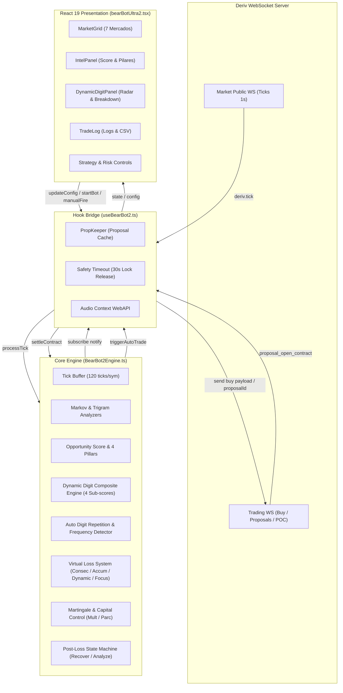
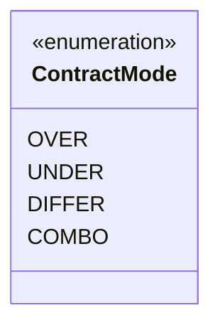
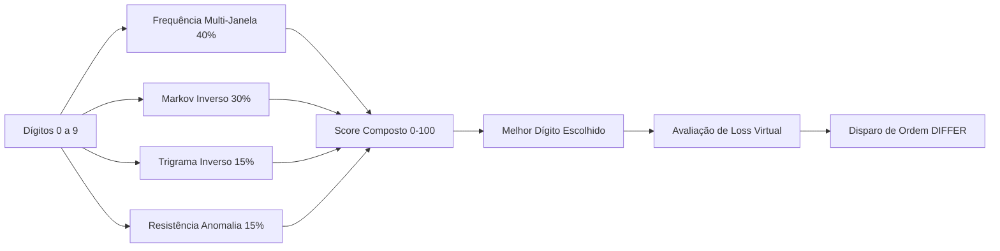
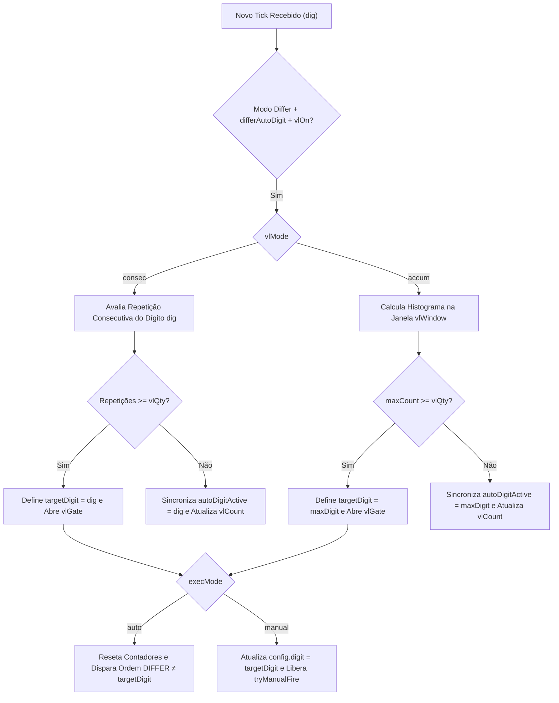
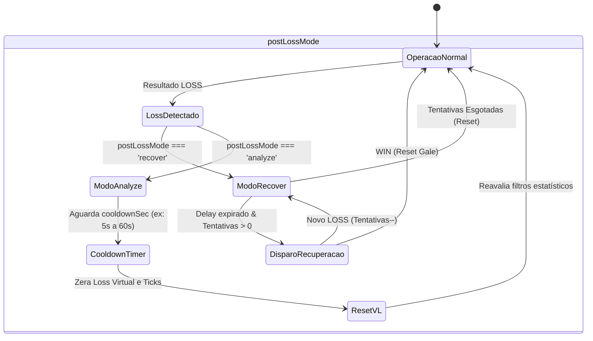

# Bear Bot Ultra 2 (v10.0 Refatorado) — Guia Técnico e Manual de Referência Completo

Este documento é o manual técnico definitivo sobre a arquitetura, modelos matemáticos, algoritmos estatísticos, máquina de estados, regras de negócio e integração do **Bear Bot Ultra 2 (v10.0 Refatorado)** no ecossistema `bot-trader`. 

Ele foi estruturado com rigor para que **Inteligências Artificiais** e **desenvolvedores** possam consultar, manter, depurar e evoluir o sistema com precisão cirúrgica sem introduzir regressões ou quebrar invariantes de trading.

---

## 1. Visão Geral e Inovações do Bear Bot Ultra 2

O **Bear Bot Ultra 2** representa uma reformulação arquitetural completa em relação à versão legada. Seu objetivo central é oferecer uma plataforma de alta performance para operações baseadas em dígitos em índices sintéticos da corretora [Deriv](https://deriv.com), combinando inteligência probabilística multi-mercado em tempo real, proteção avançada de capital e execução ultra-rápida.

### Principais Inovações em Relação à Versão 1:
1. **Engine 100% Desacoplada (`BearBot2Engine.ts`)**: Lógica de trading e cálculos matemáticos isolados em TypeScript puro, completamente desacoplados do ciclo de vida e renderização do React 19.
2. **Radar de Dígitos Dinâmicos (Score Composto de 4 Pilares)**: Análise estocástica a cada tick que seleciona dinamicamente o dígito estatisticamente mais seguro para operações `DIFFER`, avaliando 4 sub-modelos concorrentes (Frequência Ponderada Multi-Janela 40%, Cadeia de Markov Inversa 30%, Trigramas Inversos 15% e Resistência à Anomalia 15%).
3. **Dígito Dinâmico com Suporte Pleno a Loss Virtual**: Rastreamento contínuo de perdas virtuais contra o dígito dinâmico calculado a cada tick, suportando regimes Consecutivo e Acumulado em janela deslizante.
4. **Dígito Automático no Modo Differ (`differAutoDigit`)**: Algoritmo que detecta repetições consecutivas ou picos de frequência em janela deslizante gerados pelo Loss Virtual, adotando o dígito perdedor como alvo automático para aposta em `DIFFER`.
5. **Inteligência Probabilística Cross-Market (Score de Oportunidade 0–100)**: Avaliação contínua dos 7 mercados sintéticos baseada em 4 pilares com pesos parametrizáveis pelo perfil de IA (**Conservador**, **Equilibrado** ou **Agressivo**).
6. **Modo Dual-Leg Combo (OVER + UNDER Simultâneo)**: Execução coordenada de duas pernas independentes com liquidação unificada de PnL e suporte a degradação elegante (*demotion*) em caso de falha de uma das pernas.
7. **Prevenção Robusta de Travamentos e Stale Closures**: Substituição de closures estagnadas por listeners desacoplados, além de *Safety Timeouts* de 30s que destravam a engine automaticamente em caso de perdas de pacote no WebSocket.
8. **PropKeeper e Quick Buy (Sub-10ms)**: Manutenção proativa de propostas abertas no WebSocket (`proposal: 1, subscribe: 1`), permitindo compras imediatas pelo `proposal.id` em 1 tick.
9. **Contagem sob Foco (`vlFocusOnly`)**: Isolamento estrito de contagem de perdas virtuais e repetições apenas para o mercado ativo em foco, impedindo compras acidentais por acúmulos fantasmas fora de visão.
10. **Paper Trading Nativo**: Simulação local determinística com avaliação de resultado por tick e contabilidade de PnL e Martingale sem risco de capital.
11. **Proteções Pós-Loss Configuráveis**: Modos alternáveis entre **Recuperação Ativa** (disparos rápidos com Martingale) e **Análise Estocástica** (cooldown obrigatório e reavaliação de filtros estatísticos).

---

## 2. Estrutura de Arquivos e Arquitetura

O módulo segue o padrão arquitetural de **Separação de Responsabilidades (SoC)**:

```
src/
├── app/
│   ├── (withSidebar)/
│   │   └── bear-bot-ultra-2/
│   │       ├── page.tsx                         # Rota Next.js e verificação de autenticação
│   │       ├── bearBotUltra2.tsx                # Orquestrador visual principal (UI / Layout)
│   │       └── components/
│   │           ├── DynamicDigitPanel.tsx        # Painel Dedicado do Radar de Dígitos Dinâmicos
│   │           ├── IntelPanel.tsx               # Painel de IA do Mercado Ativo & Ranking
│   │           ├── MarketGrid.tsx               # Grid dos 7 Mercados & Indicadores Cross-Market
│   │           └── TradeLog.tsx                 # Console de Logs & Exportação CSV
│   ├── hooks/
│   │   └── useBearBot2.ts                       # Hook Bridge (React <-> Deriv WebSocket <-> Engine)
│   └── services/
│       ├── BearBot2Engine.ts                    # Motor de Trading Puro (TypeScript sem React)
│       └── bearbot2.types.ts                    # Tipos, Interfaces e Constantes do Domínio
└── __tests__/
    ├── bearBot2AutoDigit.test.ts                # Testes Unitários do Dígito Automático no Differ
    ├── bearBot2AutoDigitFocus.test.ts           # Testes de Dígito Automático sob Foco (vlFocusOnly)
    ├── bearBot2Combo.test.ts                    # Testes do Modo Combo Dual-Leg
    ├── bearBot2DynamicDigit.test.ts             # Testes do Radar de Dígitos Dinâmicos (Score Composto)
    ├── bearBot2DynamicDigitVL.test.ts           # Testes de Dígitos Dinâmicos integrados com Loss Virtual
    ├── bearBot2FocusVirtualLossGate.test.ts     # Testes do gate de Loss Virtual sob foco e da barreira congelada
    ├── bearBot2Engine.test.ts                   # Testes Centrais do Motor de Trading
    ├── bearBot2EnginePostLoss.test.ts           # Testes da Máquina de Pós-Loss
    ├── bearBot2PatternAB.test.ts                # Testes de Padrões de Markov A -> B
    ├── bearBot2QuickBuy.test.ts                 # Testes de Proposals e Compra Rápida Sub-10ms
    ├── bearBotUltra.test.tsx                    # Testes de Regressão da Versão Ultra 1
    ├── bearBotUltra2.test.tsx                   # Testes de Integração da Página React do Bear Bot 2
    ├── bearBotUltra2AutoDigitUI.test.tsx        # Testes de Interface dos Controles do Dígito Automático
    ├── bearBotUltra2ComboUI.test.tsx            # Testes de Interface do Modo Combo
    ├── bearBotUltra2PageAccess.test.tsx         # Testes de Acesso e Guard de Autenticação
    └── bearBotUltra2PostLoss.test.tsx           # Testes de Interface dos Controles de Pós-Loss
```

### Diagrama de Fluxo de Dados:



---

## 3. Mercados Suportados e Precisão de Dígitos

O robô opera sobre **7 índices sintéticos contínuos** da Deriv. Como o último dígito é a base de todas as tomadas de decisão, a precisão de casas decimais (*pip size*) de cada índice deve ser rigorosamente respeitada:

| Símbolo (`sym`) | Nome do Índice (`nm`) | Pip Size (Casas Decimais) | Exemplo de Preço | Último Dígito Extraído |
| :--- | :--- | :---: | :---: | :---: |
| `R_100` | Volatilidade 100 | **2** | `1234.56` | **6** |
| `R_75` | Volatilidade 75 | **4** | `8543.2198` | **8** |
| `R_50` | Volatilidade 50 | **4** | `3421.5672` | **2** |
| `R_25` | Volatilidade 25 | **3** | `1987.654` | **4** |
| `R_10` | Volatilidade 10 | **3** | `6543.210` | **0** |
| `RDBEAR` | Bear Market Index | **4** | `4321.8765` | **5** |
| `RDBULL` | Bull Market Index | **4** | `7890.1234` | **4** |

### Algoritmo de Extração de Dígito (`extractLastDigit`):
```typescript
export function extractLastDigit(price: number, symbol: string): number | null {
  const pipSizes: Record<string, number> = {
    R_100: 2, R_75: 4, R_50: 4, R_25: 3, R_10: 3,
    RDBEAR: 4, RDBULL: 4,
  };
  const pip = pipSizes[symbol];
  if (pip === undefined) return null;
  const priceStr = price.toFixed(pip);
  return Number(priceStr.slice(-1));
}
```

---

## 4. Modos de Operação e Condições de Vitória

O Bear Bot Ultra 2 suporta 4 modalidades fundamentais de contrato com barreiras matemáticas distintas:



### 4.1 Modo OVER (`DIGITOVER`)
* **Condição de Vitória:** O último dígito final $r > \text{digit}$.
* **Conjunto de Perdedores:** $\{0, 1, \dots, \text{digit}\}$.
* **Taxa de Acerto Teórica:** $\frac{9 - \text{digit}}{10} \times 100\%$.

### 4.2 Modo UNDER (`DIGITUNDER`)
* **Condição de Vitória:** O último dígito final $r < \text{digit}$.
* **Conjunto de Perdedores:** $\{\text{digit}, \text{digit}+1, \dots, 9\}$.
* **Taxa de Acerto Teórica:** $\frac{\text{digit}}{10} \times 100\%$.

### 4.3 Modo DIFFER (`DIGITDIFF`)
* **Condição de Vitória:** O último dígito final $r \neq \text{digit}$.
* **Conjunto de Perdedores:** $\{\text{digit}\}$ (apenas o dígito alvo).
* **Taxa de Acerto Teórica:** $90\%$.

O modo `DIFFER` conta com **4 modalidades de seleção de dígito alvo**:

| Modalidade | Chave de Configuração | Requisitos | Descrição Operacional |
| :--- | :--- | :--- | :--- |
| **Manual Fixo** | Padrão | N/A | O operador seleciona manualmente um dígito de $0$ a $9$ nos botões. |
| **Dígito Dinâmico** | `differDynamicDigit: true` | N/A (opcional `vlOn`) | Avalia 4 sub-modelos a cada tick e seleciona o dígito estatisticamente mais frio/seguro. Suporta Loss Virtual nativo. |
| **Dígito Automático** | `differAutoDigit: true` | Exige `vlOn: true` e `differDynamicDigit: false` | Detecta repetições consecutivas ou acúmulos por janela do Loss Virtual e seleciona o dígito perdedor como alvo. |
| **Padrão $A \to B$** | `patTrigger: true` | Exige `differDynamicDigit: false` e `differAutoDigit: false` | Monitora transições probabilísticas armadas. Quando sai o dígito $A$, entra em Differ contra o dígito $B$. |

> [!NOTE]
> **Regra de Exclusão Mútua na Interface:**
> Ao ativar o toggle `differDynamicDigit`, o sistema automaticamente desativa `differAutoDigit` e `patTrigger`. Da mesma forma, os seletores manuais de dígito fixo (0 a 9) ficam desabilitados/opacos para evitar inconsistências de estado.

### 4.4 Modo COMBO (Dual-Leg Simultâneo)
O modo **COMBO** adquire simultaneamente duas pernas independentes de proteção:
* Perna 1: `DIGITOVER` com barreira `comboOver` (Padrão: 5).
* Perna 2: `DIGITUNDER` com barreira `comboUnder` (Padrão: 4).
* **Condição de Vitória:** $r < \text{comboUnder} \lor r > \text{comboOver}$.
* **Zona de Perda:** $\min(\text{comboUnder}, \text{comboOver}) \le r \le \max(\text{comboUnder}, \text{comboOver})$.
* **Mecânica de Execução e Degradação Elegante (*Demotion*):**
  * O bot submete duas ordens `buy` com stakes individuais.
  * Se ambas as ordens forem aceitas, o bot aguarda a liquidação das duas pernas (`comboPending.legs = 2`), somando os lucros líquidos. O trade só é considerado `LOSS` se ambas as pernas perderem.
  * Se uma perna for aceita e a outra for rejeitada pela corretora (ex: erro de saldo ou cotação), a engine aciona `demoteComboToSingle()`, rebaixando o trade imediatamente para uma operação de perna única sem quebrar o controle de Martingale ou travar a aplicação.

---

## 5. Cérebro de Inteligência Artificial: Score de Oportunidade e os 4 Pilares

O **Score de Oportunidade** ($0$ a $100$) é a métrica mestra calculada a cada 3 ticks para todos os 7 índices simultaneamente. Ele decide se o robô tem permissão para operar automaticamente e qual mercado deve receber o foco de operações.

### 5.1 A Fórmula de Cálculo
$$\text{OpportunityScore} = (100 - \text{Pressure}) \times w_{\text{Pressure}} + \text{PatternStrength} \times w_{\text{Pattern}} + \text{VLProgress} \times w_{\text{VL}} + \text{SyncScore} \times w_{\text{Sync}}$$

### 5.2 Ponderação por Perfil de IA (`aiMode`)
Os pesos dos 4 pilares adaptam-se dinamicamente conforme o perfil selecionado pelo trader:

| Perfil de IA | Pressão ($w_{\text{Pressure}}$) | Padrão ($w_{\text{Pattern}}$) | Loss Virtual ($w_{\text{VL}}$) | Sincronia ($w_{\text{Sync}}$) | Foco Principal |
| :--- | :---: | :---: | :---: | :---: | :--- |
| **Conservador** | **0.45 (45%)** | 0.20 (20%) | 0.25 (25%) | 0.10 (10%) | Máxima aversão a anomalias e excesso de perdedores |
| **Equilibrado** *(Padrão)* | **0.35 (35%)** | 0.25 (25%) | 0.25 (25%) | 0.15 (15%) | Balanceamento ideal de todos os fatores |
| **Agressivo** | **0.25 (25%)** | **0.30 (30%)** | 0.20 (20%) | **0.25 (25%)** | Aproveitamento de padrões fortes e confirmação cruzada |

---

### 5.3 Os 4 Pilares Detalhados

#### Pilar 1: Pressão de Perdedores (`100 - pressure`)
Avalia a concentração recente de dígitos perdedores comparando 3 janelas deslizantes (10, 25 e 50 ticks) contra a fração teórica esperada $E = \frac{|\text{Losers}|}{10}$:
$$\text{Excess}_n = \frac{f_n - E}{\max(E, 0.05)}$$
$$\text{Pressure} = \text{clamp}\left(0, 100, \text{round}\left(\frac{\text{Excess}_{10} + \text{Excess}_{25} + \text{Excess}_{50}}{3} \times 100\right)\right)$$
* Se dígitos perdedores saíram em excesso, a pressão é alta (ex: 70%), derrubando a segurança do mercado para $100 - 70 = 30\%$.

#### Pilar 2: Força do Padrão $A \to B$ (`patternStrength`)
Mede a consistência estocástica de repetição do par $A \to B$:
* Se o padrão estiver armado (`armed = true`): Pontuação base de **40%**.
* **Bônus Adicionais:**
  * Força Condicional $P(B \mid A) \ge 0.50$: **+20%**
  * Limite Inferior de Wilson $LB \ge 0.30$: **+15%**
  * Lift Estatístico $\frac{P(B \mid A)}{P(B)} \ge 1.50$: **+15%**
  * Estabilidade Temporal $\ge 3$ ticks consecutivos: **+10%**
* Pontuação máxima: **100%**.

#### Pilar 3: Progresso de Loss Virtual (`vlProgress`)
Mede a proximidade de abertura do gatilho de Loss Virtual configurado (`vlQty`):
$$\text{VLProgress} = \min\left(100, \text{round}\left(\frac{\text{Count}}{\text{vlQty}} \times 100\right)\right)$$
* Se o Loss Virtual estiver desativado ou o gatilho atingido, contribui com **100%**.

#### Pilar 4: Sincronia Cross-Market (`syncScore`)
Mede a ocorrência simultânea do mesmo par $A \to B$ nos outros 6 mercados monitorados:
$$\text{SyncScore} = \min\left(100, \text{round}\left(\frac{\text{Outros Mercados com o mesmo } A \to B}{3} \times 100\right)\right)$$

---

### 5.4 Classificação e Portão de IA (AI Gate)

| Faixa do Score | Classificação (`recommendation`) | Rótulo Visual | Ação Recomendada |
| :---: | :---: | :---: | :--- |
| **80 a 100** | `strong_buy` | ⭐ **COMPRA FORTE** | Condições ideais. IA autoriza entrada plena. |
| **60 a 79** | `buy` | ✓ **COMPRA** | Mercado favorável. Operação segura. |
| **40 a 59** | `neutral` | ◌ **NEUTRO** | Condições medianas. Entrada permitida no limite inferior. |
| **20 a 39** | `avoid` | ✕ **EVITAR** | **Bloqueio de Entrada.** Anomalias ou pressão alta. |
| **0 a 19** | `strong_avoid` | ⛔ **EVITAR FORTE** | **Bloqueio Rigoroso.** Risco extremo de perda. |

> [!IMPORTANT]
> **Regra do AI Gate:**
> No modo automático, o robô exige `OpportunityScore === aiMinScore` para abrir ordens reais: só entra com o score exatamente igual ao mínimo, acima ou abaixo dele a ordem é abortada. O `aiMinScore` é editável no campo **Score mín.** do painel IA Cross-Market (0 a 100, padrão 40); `0` desliga o veto. A exceção é o modo pós-loss `recover`; o Loss Virtual é exigido à parte, em conjunto com o score. No modo Múltiplos Mercados, o mercado em foco só segura o foco contra um candidato de score maior enquanto estiver exatamente no score mínimo (ou ainda coletando histórico).

---

## 6. Radar de Dígitos Dinâmicos (Score Composto e Integração com Loss Virtual)

O **Radar de Dígitos Dinâmicos** (`differDynamicDigit`) é um motor estatístico avançado projetado para superar a vulnerabilidade da escolha de dígitos estáticos no modo `DIFFER`. A cada novo tick recebido, ele avalia individualmente todos os dígitos de $0$ a $9$ através de **4 sub-modelos estocásticos**, identificando o dígito com menor probabilidade estatística de sair no próximo tick.



### 6.1 Os 4 Sub-Scores do Modelo Composto

Para cada dígito candidato $d \in \{0, 1, \dots, 9\}$:

1. **Score de Frequência Multi-Janela ($S_F$ — Peso 40%):**
   Combina as frequências de $d$ nas últimas 10, 25 e 50 rodadas:
   $$f_{\text{pond}} = 0.5 \times f_{10}(d) + 0.3 \times f_{25}(d) + 0.2 \times f_{50}(d)$$
   $$S_F(d) = \text{clamp}\left(0, 100, \text{round}\left(100 \times \left(1 - \frac{f_{\text{pond}}}{0.30}\right)\right)\right)$$

2. **Score de Markov Inverso ($S_M$ — Peso 30%):**
   Calcula a probabilidade de transição empírica do dígito do último tick ($\text{lastDigit}$) para o candidato $d$:
   $$P_{\text{Markov}}(d \mid \text{lastDigit}) = \frac{\text{Ocorrências de } (\text{lastDigit} \to d)}{\text{Total de Ocorrências de } \text{lastDigit}}$$
   $$S_M(d) = \text{clamp}\left(0, 100, \text{round}\left(100 \times \left(1 - \frac{P_{\text{Markov}}}{0.30}\right)\right)\right)$$

3. **Score de Trigramas Inversos ($S_T$ — Peso 15%):**
   Calcula a probabilidade de transição considerando o par de dígitos anterior $(\text{prevDigit}, \text{lastDigit}) \to d$ nos últimos 50 ticks:
   $$P_{\text{Tri}}(d \mid \text{prev}, \text{last}) = \frac{\text{Ocorrências de } (\text{prev}, \text{last} \to d)}{\text{Total de Ocorrências de } (\text{prev}, \text{last})}$$
   $$S_T(d) = \text{clamp}\left(0, 100, \text{round}\left(100 \times \left(1 - \frac{P_{\text{Tri}}}{0.40}\right)\right)\right)$$

4. **Score de Resistência à Anomalia ($S_A$ — Peso 15%):**
   Mede o desvio estocástico do candidato $d$ em relação à média esperada ($10\%$) na janela de 25 ticks:
   $$\text{Excess}(d) = \frac{f_{25}(d) - 0.10}{0.10}$$
   $$S_A(d) = \text{clamp}(0, 100, \text{round}(50 - \text{Excess}(d) \times 50))$$

### 6.2 O Score Composto Final e Critérios de Desempate
$$S_C(d) = \text{round}(0.40 S_F(d) + 0.30 S_M(d) + 0.15 S_T(d) + 0.15 S_A(d))$$

**Regra de Seleção do Dígito Vencedor:**
1. Dígito com **maior $S_C(d)$**.
2. Em caso de empate: dígito com **menor contagem bruta nos últimos 50 ticks** (`rawCount50`).
3. Em caso de novo empate: dígito de **menor valor nominal** ($0 < 1 < \dots < 9$).

---

### 6.3 Integração do Dígito Dinâmico com Loss Virtual (`vlOn`)

Quando o Loss Virtual está ativado juntamente com o Radar de Dígitos Dinâmicos:

1. **Cálculo da Perda Virtual Dinâmica por Tick:**
   * A cada tick recebido com dígito $d_t$, a engine calcula qual era o dígito dinâmico recomendado com base no histórico imediatamente anterior:
     $$\text{dynDigit} = \text{computeDynamicDifferDigit}(\text{sym}, \text{digits}_{< t}).\text{digit}$$
   * Uma perda virtual é registrada se e somente se o dígito do tick for igual ao dígito dinâmico:
     $$\text{isLoser} = (d_t == \text{dynDigit})$$
   * O resultado binário ($1$ para perda, $0$ para vitória) é empurrado para o buffer `vlLossHistory[sym]`.

2. **Modo Consecutivo (`vlMode: 'consec'`) — coerência de alvo obrigatória:**
   * O dígito previsto que sofreu a perda é memorizado em `vlLossDigit[sym]`.
   * Se $\text{isLoser} = \text{true}$ e $\text{dynDigit} = \text{vlLossDigit}[\text{sym}] \implies \text{vlCount} = \text{vlCount} + 1$.
   * Se $\text{isLoser} = \text{true}$ e $\text{dynDigit} \ne \text{vlLossDigit}[\text{sym}] \implies \text{vlCount} = 1$ e `vlLossDigit[sym] = dynDigit` (a sequência recomeça, porque perdas consecutivas só se somam contra o **mesmo** dígito de previsão).
   * Se $\text{isLoser} = \text{false} \implies \text{vlCount} = 0$ e `vlLossDigit[sym] = null`.

3. **Modo Acumulado (`vlMode: 'accum'`):**
   * Avalia a janela deslizante de tamanho $\text{windowSize} = \min(\text{ticksSinceReset}[\text{sym}], \text{vlWindow})$.
   * Conta a quantidade de perdas no slice `vlLossHistory[sym].slice(-windowSize)`:
     $$\text{vlCount} = \sum_{x \in \text{slice}} x$$
   * `vlLossDigit[sym]` guarda o dígito previsto da perda virtual mais recente da janela e é limpo quando a janela zera.

4. **Portão de disparo (`vlDynGateOpen`) — as três condições obrigatórias:**
   O gate do Dígito Dinâmico só abre quando **todas** as condições abaixo são verdadeiras, e é reavaliado no instante exato do disparo (não no instante do registro do candidato):
   * $\text{vlCount} \ge \text{vlQty}$ — perdas virtuais suficientes;
   * $\text{ticksSinceReset}[\text{sym}] \ge \text{vlQty}$ — as perdas foram observadas de fato **sob foco**, já que `ticksSinceReset` é zerado em toda troca de foco (`vlResetM`);
   * $\text{vlLossDigit}[\text{sym}] \ne \text{null}$ — existe um dígito perdedor identificado.

5. **Barreira congelada no dígito perdedor (`lockedDigit`):**
   * Ao abrir o gate, `lockDynamicDigit(sym)` grava `config.digit = vlLossDigit[sym]` e congela esse valor em `lockedDigit`.
   * `prepareTrade()` e `getRequiredProposals()` passam a resolver a barreira por `resolveDynamicBarrier()`, que devolve `lockedDigit` enquanto ele existir, em vez de recalcular o radar. Isso é indispensável porque o hook chama `prepareTrade` em `setTimeout(0)` e novos ticks podem chegar antes da compra: sem o congelamento, a ordem real era enviada contra um dígito que nunca sofreu perda virtual.
   * O congelamento é liberado em `settleContract()`, `abortPendingTrade()`, `abortOp()`, `resetStats()`, `startBot()` e na troca entre conta real e Paper Trading.
   * Único bypass legítimo do gate: a **Recuperação Ativa** pós-loss (`postLossOn` com `postLossMode: 'recover'`), que opera com o dígito dinâmico corrente.

6. **Sincronização Contínua e Modo Manual:**
   * `config.digit` é atualizado em tempo real para o dígito dinâmico a cada tick apenas enquanto não houver barreira congelada, para que a UI nunca mostre um alvo diferente do que será comprado.
   * No modo manual, `tryManualFire()` valida o gate e, com Loss Virtual ativo, exige `vlLossDigit` definido — a compra manual usa o dígito perdedor, não o dígito dinâmico recalculado.

---

## 7. Dígito Automático com Loss Virtual no Modo Differ (`differAutoDigit`)

O **Dígito Automático** (`differAutoDigit`) é uma estratégia estocástica voltada para o modo `DIFFER` combinada com o **Loss Virtual** (`vlOn: true`). Em vez de o trader fixar manualmente um dígito, o bot monitora dinamicamente repetições ou picos de frequência que geraram perdas virtuais e adota esse dígito perdedor como o alvo da operação `DIFFER`.



### 7.1 Lógica no Modo Consecutivo (`vlMode: 'consec'`)

* **Gatilho de Entrada:** O robô monitora a repetição consecutiva do mesmo dígito a partir do momento em que o bot foi iniciado ou resetado (`ticksSinceReset`).
* **Exemplo Prático:** Com `vlQty = 3`, se a sequência de ticks for `3, 4, 2, 4, 2, 4, 7, 7, 7`:
  1. No primeiro `7`: `vlCount = 1`, `autoDigitActive = 7`, `config.digit = 7`.
  2. No segundo `7`: `vlCount = 2`, `autoDigitActive = 7`, `config.digit = 7`.
  3. No terceiro `7`: `vlCount = 3`, `autoDigitTarget = 7`, `config.digit = 7` $\implies$ **Disparo de trade `DIFFER ≠ 7`**.
* **Prevenção de Disparos em Cascata (Anti-Cascade Reset):**
  * Imediatamente após a ordem ser disparada, `ticksSinceReset`, `autoDigitTarget` e `vlCount` são zerados.
  * Se o próximo tick for novamente `7` (4º '7' consecutivo), o bot não dispara uma nova ordem, pois exige uma nova sequência completa de `vlQty` repetições a partir do ponto de reset.

### 7.2 Lógica no Modo Acumulado (`vlMode: 'accum'`)

* **Gatilho de Entrada:** Avalia a janela deslizante de tamanho $\text{windowSize} = \min(\text{ticksSinceReset}[\text{sym}], \text{vlWindow})$.
* **Cálculo da Frequência:**
  * Computa a frequência de cada dígito $d \in \{0, \dots, 9\}$ dentro do slice recente de ticks.
  * Determina o dígito com maior frequência ($\text{maxDigit}$ com contagem $\text{maxCount}$).
* **Exemplo Prático:** Com `vlQty = 4` e `vlWindow = 15`:
  * Sequência de ticks: `1, 2, 5, 6, 2, 6, 7, 2, 2` (4 ocorrências do dígito $2$ dentro de 9 ticks sob a janela de 15).
  * No 9º tick, $\text{maxCount} = 4 \ge \text{vlQty} \implies$ `targetDigit = 2`, `config.digit = 2` $\implies$ **Disparo de trade `DIFFER ≠ 2`**.
* **Isolamento de Janela:** A janela avaliada é estritamente limitada por `ticksSinceReset`, prevenindo que dados antigos anteriores ao início da estratégia causem falsos disparos.

### 7.3 Sincronização em Tempo Real (`autoDigitBySym` e `config.digit`)

Durante o processamento de cada tick, mesmo antes de a meta `vlQty` ser atingida:
* A engine atualiza o mapa `autoDigitBySym[sym]` com o dígito perdedor detectado até aquele momento.
* `config.digit` do mercado ativo é atualizado continuamente, permitindo que a interface gráfica exiba o dígito alvo provável em tempo real.

### 7.4 Integração com Contagem sob Foco (`vlFocusOnly`)

Quando `multiOn = true` e `vlFocusOnly = true`:
* **Isolamento de Mercados:** Apenas o mercado em foco acumula repetições e perdas virtuais.
* **Migração de Foco:** Se o robô ou usuário alternar o mercado ativo (ex: de `R_100` para `R_50`), o contador do mercado anterior e do novo mercado são resetados a zero.
* **Maturidade sob Foco:** O disparo do trade só ocorre quando a sequência de repetições do dígito for formada inteiramente sob o campo de foco do mercado ativo.

---

## 8. Comparativo dos Modos de Seleção de Dígito no Differ

| Característica | Manual Fixo | Padrão $A \to B$ (`patTrigger`) | Dígito Automático (`differAutoDigit`) | Radar Dinâmico (`differDynamicDigit`) |
| :--- | :--- | :--- | :--- | :--- |
| **Origem do Dígito** | Escolha do usuário (0–9) | Probabilidade condicional $P(B \mid A)$ | Dígito repetido que causou perdas virtuais | Score Composto multi-estocástico (4 sub-scores) |
| **Exige Loss Virtual?** | Opcional | Opcional | **Obrigatório (`vlOn: true`)** | Opcional (suporte nativo a Consecutivo e Acumulado) |
| **Freq. de Atualização** | Estático até alteração manual | Atualiza quando $A \to B$ é detectado | Atualiza a cada repetição ou tick na janela | Atualiza a cada novo tick recebido |
| **Painel Visual Dedicado** | Seletor de botões 0–9 | Indicador de Força/Lift no IntelPanel | Tag "DÍGITO AUTO ATIVO" no Seletor | `DynamicDigitPanel` com Ranking 0–9 e 4 Pilares |
| **Melhor Cenário** | Mercados simétricos | Mercados com forte correlação sequencial | Mercados com anomalias pontuais de repetição | Mercados voláteis com assimetrias multi-janela |

---

## 9. Modelos Estatísticos Adicionais: Qui-Quadrado ($\chi^2$) e Padrões $A \to B$

### 9.1 Teste de Aderência Qui-Quadrado ($\chi^2$)
Executado nos últimos 50 ticks (mínimo de 30 ticks) para validar se a distribuição dos 10 dígitos diverge significativamente da distribuição uniforme teórica ($E = \frac{N}{10}$):
$$\chi^2 = \sum_{d=0}^{9} \frac{(O_d - E)^2}{E}$$
* $\chi^2 \ge 21.7 \implies \text{Nível Alto}$ ($p < 0.01$ — Anomalia extrema de distribuição).
* $\chi^2 \ge 16.9 \implies \text{Nível Médio}$ ($p < 0.05$ — Assimetria estatística moderada).
* $\chi^2 < 16.9 \implies \text{Nível Normal}$ (Distribuição uniforme saudável).

### 9.2 Validação Rigorosa de Padrões $A \to B$
A detecção do par $A \to B$ utiliza 4 filtros probabilísticos simultâneos para evitar falsos positivos:
1. **Probabilidade Condicional:** $P(B \mid A) \ge \frac{\text{patMinForce}}{100}$ (Padrão: $30\%$).
2. **Intervalo de Confiança Wilson Lower Bound:**
   $$LB = \frac{p + \frac{z^2}{2n} - z \sqrt{\frac{p(1-p) + z^2/(4n)}{n}}}{1 + \frac{z^2}{n}} \quad (\text{com } z = 1.96)$$
   Exige $LB \ge \max(0.15, \text{minForce} \times 0.7)$.
3. **Lift Estatístico:** $\text{Lift} = \frac{P(B \mid A)}{P(B)} \ge 1.15$ (Obriga correlação real superior à probabilidade marginal).
4. **Estabilidade Temporal:** Exige persistência do padrão por pelo menos 2 ticks consecutivos (`stable >= 2`).

---

## 10. Sistema de Loss Virtual (VL) e Contagem sob Foco

O Loss Virtual simula perdas fictícias em background para filtrar momentos desfavoráveis do mercado.

### 10.1 As 3 Modalidades de Rastreamento de Loss Virtual:
1. **Loss Virtual Tradicional (OVER, UNDER, COMBO e DIFFER Fixo):**
   * Avalia os dígitos perdedores definidos por `buildLoserSet(mode, digit)`.
2. **Loss Virtual com Dígito Automático (`differAutoDigit`):**
   * Rastreia repetições do mesmo dígito ou picos de frequência em janela deslizante.
3. **Loss Virtual com Dígito Dinâmico (`differDynamicDigit`):**
   * Avalia a cada tick se o dígito emitido foi idêntico ao dígito dinâmico recomendado calculado com base nos ticks anteriores (`vlLossHistory`).

### 10.2 Isolamento Pré-Início (`ticksSinceReset`)
Para garantir que ticks anteriores ao acionamento do robô não causem falsas entradas imediatas:
* Ao iniciar o robô (`startBot`), trocar configurações ou liquidar uma operação, a variável `ticksSinceReset[sym]` é zerada.
* A janela ativa calculada é estritamente:
  $$\text{WindowSize} = \min(\text{ticksSinceReset}[sym], \text{vlWindow})$$
* A fatia de ticks utilizada previne a armadilha do `slice(-0)` do JavaScript:
  $$\text{slice} = \text{WindowSize} > 0 \;?\; \text{digits.slice}(-\text{WindowSize}) : []$$

### 10.3 Contagem sob Foco (`vlFocusOnly`)
Quando ativado no modo Multi-Mercado (`multiOn = true`):
* Apenas o mercado em foco acumula perdas virtuais.
* Ao trocar de mercado (manual ou automaticamente), os contadores do mercado anterior e do novo mercado são resetados a zero, garantindo que o trader só opere após a maturação das condições sob observação ativa.

---

## 11. Gerenciamento de Capital, Martingale e Pós-Loss

### 11.1 Modos de Martingale
1. **Multiplicador Clássico (`galeMode: 'mult'`):**
   $$\text{Stake}_{\text{next}} = \text{Stake}_{\text{initial}} \times \text{Gale}^{\text{GaleLevel}}$$
   * Após vitória: $\text{GaleLevel} = 0$, retorna ao stake base.
2. **Martingale Parcelado (`galeMode: 'parc'`):**
   * Divide o prejuízo acumulado $\text{LossAcum}$ pelo número de parcelas configuradas $\text{galeParcels}$ (ex: 2 a 5 parcelas):
     $$\text{Stake}_{\text{next}} = \text{Stake}_{\text{initial}} + \frac{\text{LossAcum} / \text{ParcelsLeft}}{\text{Payout}}$$
   * Cada vitória deduz o lucro auferido de $\text{LossAcum}$ e consome uma parcela (`parcelsLeft--`). Quando $\text{LossAcum} \le 0$, o sistema retorna ao stake inicial.

### 11.2 Modos Pós-Loss (`postLossMode`)
Configurável via toggle `postLossOn`:



1. **Modo Recuperar (`recover`):**
   * Executa até `recoverMaxAttempts` disparos consecutivos após um intervalo de `recoverDelay` ms.
   * **Bypass de Score:** Durante a recuperação, o AI Gate é aberto para permitir a recuperação imediata.
2. **Modo Analisar (`analyze`):**
   * Pausa todas as operações durante `cooldownSec` segundos.
   * Ao expirar o tempo, reseta os contadores de Loss Virtual e exige que as condições estatísticas ideais se formem novamente.

---

## 12. Execução de Baixa Latência: PropKeeper e Pre-opened Proposals

Para atingir execução de ordens com latência inferior a **10ms**, o Bear Bot Ultra 2 mantém propostas abertas e ativas em tempo real no WebSocket da Deriv:

1. **Subscrição Contínua (`ensureProposal`):**
   * O hook calcula os contratos necessários para o setup atual através de `engine.getRequiredProposals()` (ex: `DIGITDIFF` na barreira calculada pelo dígito dinâmico, ou `DIGITOVER 5` + `DIGITUNDER 4`).
   * Envia `{ proposal: 1, subscribe: 1, amount: curStake, ... }` com uma chave passthrough única (`sym|contract_type|barrier|stake`).
2. **Execução Instantânea por `proposal.id`:**
   * Quando o sinal de compra é disparado, a engine envia o payload de compra rápida:
     $$\text{Payload} = \{ \text{buy}: \text{proposalId}, \text{price}: \text{stake} \}$$
   * A corretora processa o preenchimento no próximo tick disponível sem recálculo de preço.
3. **PropKeeper (Manutenção Cíclica):**
   * Um temporizador a cada 4 segundos (`useEffect`) valida se as propostas continuam prontas e renova propostas consumidas ou invalidadas após alterações de stake ou mercado.

---

## 13. Proteções de Taxa, Timeouts e Concorrência

| Mecanismo de Segurança | Arquivo de Implementação | Descrição |
| :--- | :--- | :--- |
| **`tradeLock`** | [`BearBot2Engine.ts`](../../src/app/services/BearBot2Engine.ts) | Trava atômica que impede abertura de novas ordens enquanto houver uma operação em andamento ou pendente de liquidação. |
| **`maxTradesHour`** | [`BearBot2Engine.ts`](../../src/app/services/BearBot2Engine.ts) | Limita a quantidade máxima de trades em uma janela deslizante de 60 minutos (1 a 500 trades/h). |
| **`tradeCooldownMs`** | [`BearBot2Engine.ts`](../../src/app/services/BearBot2Engine.ts) | Impõe intervalo mínimo obrigatório entre o fim de uma operação e o início da próxima (0 a 600.000 ms). |
| **`SAFETY_TIMEOUT_MS` (30s)** | [`useBearBot2.ts`](../../src/app/hooks/useBearBot2.ts) | Se a Deriv não enviar a confirmação de encerramento (`proposal_open_contract`) em 30 segundos, o bot destrava automaticamente chamando `abortPendingTrade`, sem afetar PnL ou Martingale. |
| **Anti-Flicker Switch (3s)** | [`BearBot2Engine.ts`](../../src/app/services/BearBot2Engine.ts) | Trava temporal de 3 segundos entre trocas automáticas de mercado na tela para evitar fadiga visual e oscilações concorrentes. |

---

## 14. Cronograma de Ativação Progressiva por Ticks

O robô inicializa suas análises estocásticas de forma progressiva à medida que os ticks chegam do WebSocket:

```
[0 ticks]    Início da coleta
  │
  ├─► [3 ticks]   ⚡ Atualização do Score de IA (Ciclos de 3 em 3 ticks)
  │
  ├─► [5 ticks]   🎯 Radar de Dígitos Dinâmicos inicializa cálculo do Score Composto
  │
  ├─► [8 ticks]   🔍 Detecção de Padrões A -> B de Markov ativada
  │
  ├─► [10 ticks]  📊 Taxa Observada de Win Rate exibida no painel
  │
  ├─► [12 ticks]  ⚠️ Anomalia de Mercado recente (Janela de 25 ticks)
  │
  ├─► [30 ticks]  📐 Teste de Bondade de Ajuste Qui-Quadrado (χ²)
  │
  └─► [50 ticks]  🎯 ANÁLISE COMPLETA CONCLUÍDA (Status "coletando dados" -> Liberação Plena)
```

---

## 15. Suíte de Testes Automatizados (Vitest)

O Bear Bot Ultra 2 possui cobertura massiva de **15 suítes de testes unitários e de integração com 151 cenários validados**:

### Comandos de Execução dos Testes:
```bash
# Executar todas as 15 suítes de testes do Bear Bot 2
npx vitest run src/__tests__/bearBot*

# Executar testes específicos de Dígitos Dinâmicos
npx vitest run src/__tests__/bearBot2DynamicDigit.test.ts
npx vitest run src/__tests__/bearBot2DynamicDigitVL.test.ts
npx vitest run src/__tests__/bearBot2FocusVirtualLossGate.test.ts

# Executar testes específicos de Dígito Automático
npx vitest run src/__tests__/bearBot2AutoDigit.test.ts
npx vitest run src/__tests__/bearBot2AutoDigitFocus.test.ts

# Executar testes de Interface React
npx vitest run src/__tests__/bearBotUltra2.test.tsx
npx vitest run src/__tests__/bearBotUltra2AutoDigitUI.test.tsx
```

---

## 16. Guia Rápido de Consulta para Agentes de IA

Ao realizar manutenções, melhorias ou alterações no Bear Bot Ultra 2, obedeça rigorosamente às seguintes diretrizes:

1. **Nunca quebre o desacoplamento da Engine:** Toda lógica matemática, cálculo de probabilidade, controle de PnL e gestão de estado de trading pertence exclusivamente a `src/app/services/BearBot2Engine.ts`. Componentes React devem apenas exibir o estado retornado por `getState()`.
2. **Respeite a sincronização de `config.digit`:** Tanto no Dígito Dinâmico (`differDynamicDigit`) quanto no Dígito Automático (`differAutoDigit`), `config.digit` e os mapas de estado (`autoDigitBySym`) devem ser sincronizados continuamente para garantir coerência entre UI, proposals e submissão de ordens.
3. **Não altere contratos sem atualizar `buildLoserSet` e `isWinCheck`:** Essas duas funções em `bearbot2.types.ts` são a referência única de verdade para definir se um dígito é vencedor ou perdedor em qualquer modo.
4. **Isolamento de Contagem em Loss Virtual:** Sempre utilize `ticksSinceReset[sym]` ao calcular janelas de Loss Virtual para evitar falsos disparos com dados históricos defasados.
5. **Respeite o destravamento seguro (`abortPendingTrade`):** Em caso de erros de API ou abortos manuais, sempre utilize `abortPendingTrade()` para liberar a trava `tradeLock` sem registrar falsas derrotas ou avançar o Martingale indevidamente.
6. **Mantenha os testes verdes:** Toda nova funcionalidade deve vir acompanhada de testes em `src/__tests__/` e aprovada via `npx vitest run src/__tests__/bearBot*`.

---

## Persistência de Operações Reais (tabela `Operation`)

Todo contrato **real** comprado por este robô é gravado na tabela `Operation` ao ser liquidado, igual à tela de operação manual (`home`). A gravação usa `persistBotOperation(poc, accountInfo)` em `src/app/services/botOperationPersistence.ts`, que reaproveita `buildOperationRecord` e `saveOperation` (`POST /api/operation`).

- **Só conta real:** o tipo de conta vem do token ativo (`accountInfo.activeToken`). Conta demo, Paper Trading ou conta não identificada não são gravadas.
- **Só contratos do próprio robô:** POCs de outros módulos ou reenviados na reconexão do WebSocket são ignorados. Cada perna do Combo é gravada como uma operação.
- **Sem duplicidade:** o robô grava cada `contract_id` uma vez, e a rota rejeita `operationId` repetido.
- **Falha não trava o robô:** erro de rede ou POC incompleto vai para o console. PnL, martingale e trava de trade seguem normalmente.
